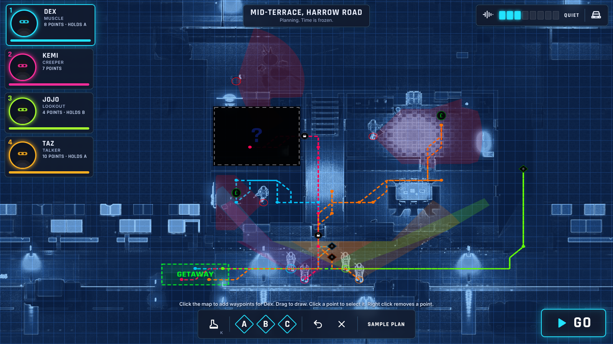
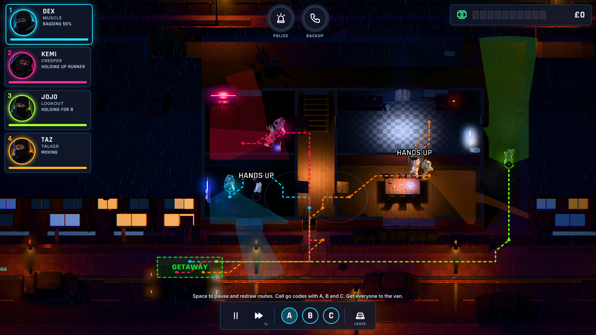

# Stickupkids

A top-down tactical heist game set on a British estate at night. You plan a raid on a blueprint of the house, draw each crew member's route, sync them with go codes, then watch it play out in real time with pause.

This is the first playable slice, built in [Babylon.js](https://www.babylonjs.com/) with TypeScript and Vite. Two jobs on a job board over a map of London: a mid-terrace on the Harrow Road estate, and the gang's weekly count in Burgess Park, a 250 by 155 m slice of the real park from Albany Road to Wells Way (map data © OpenStreetMap contributors).




## Play it

```sh
npm install
npm run dev
```

Then open http://localhost:5173. Chrome, Edge, Firefox and Safari all work; it needs WebGL.

To build a static copy for any web host: `npm run build`, then serve the `dist` folder (`npm run preview` does this locally). Once GitHub Pages is switched on (Settings > Pages > Source: GitHub Actions), every push to `main` publishes the game there.

## How to play

| Input | Planning | Raid |
|---|---|---|
| `1` to `4` or click a card | Pick a crew member | Pick a crew member |
| Click / drag on the map | Add waypoints to their route | Live: click a crew member, then where they go (drag to draw a route). Paused: redraw the picked crew member's route from where they stand |
| Click a waypoint | Select it (drag to move it) | Paused: the same |
| Right click, `Backspace` | Remove the selected point | Paused: the same |
| `A`, `B`, `C` | Hold the selected point until that go code | Call the go code. Paused with a point picked: hold it for that code |
| `K` | Kick locked doors after the selected point | Paused: the same |
| `Enter` or **Go** | Start the raid | |
| `Space` | | Pause and resume |
| `F` | | Speed 1x, 2x, 4x |
| `V` or the car button | | Drive off with whoever is at the van |
| Two fingers on a trackpad, arrow keys | Look round a big map | Look round a big map |
| Pinch, mouse wheel | Zoom | Zoom |
| Click or drag the minimap | Jump the camera there | Jump the camera there |
| Click a crew card again | Find that crew member | Find that crew member |

Locked doors are picked by default (quiet, slow; Kemi the Creeper is fastest). Kicking is fast but loud: it starts the police clock and brings guards running. Anyone who walks up on an unaware enemy holds them up (Taz the Talker is quickest); an enemy who clocks you first goes hostile, shouts for the others and starts the backup clock. Loot is bagged by walking next to it. Each kind of enemy has its own temper. A younger runs for help, shouting the place up as he goes, and brings their backup sooner; nobody shoots someone running away, but get close and you can still hold him up. The old head talks before he shoots: he gives you a few seconds, and only Taz can talk him down, after which his men stand down with him. A nervous dealer gives up easily, but if he clocks you first he grabs the nearest stash and runs for it. Dogs charge, and their barking brings everyone near. Muscle digs in at his post. Each job also has a neighbour, never red and never a target, who rings 999 if they see you and nobody gets to them first. Their lines live in `src/sim/lines.ts`.

Clean jobs pay better. Auntie Pat pays 25% more for a job with no bodies and 5% more for each hold-up (up to 20%); each body knocks 15% off and each civilian hurt 30%. Bodies also add police and rival heat and the risk of revenge. The results screen shows the sum.

Plans never survive contact, so the raid can be steered as it goes: pause with Space at any moment, redraw anyone's remaining route, add holds and go codes, then carry on; or, without pausing, click a crew member and then where they should go. Get everyone to the getaway zone by the van before the police arrive. **Load a sample plan** on the title screen shows a quiet run.

## Code layout

```
src/sim/       Game rules, no engine code: level data, grid, pathfinding,
               line of sight, crew and enemy behaviour, clocks, outcome.
src/render/    Babylon.js view: scene, lighting, blueprint post-process,
               actors, vision cones, paths and markers.
src/ui/        HTML HUD (crew cards, clocks, loot, tool bar, results).
src/main.ts    Game flow and input.
tests/         Simulation tests (node --test).
scripts/       Headless browser smoke test and screenshots (Playwright).
```

The simulation is engine-agnostic, so the rules can be tested without a browser and the renderer could be swapped later.

## Tests

```sh
npm test                                   # simulation tests
npm run dev &                              # then, with Chromium available:
node scripts/smoke.mjs http://localhost:5173/
node scripts/screenshots.mjs http://localhost:5173/ shots
```

The smoke test drives the game with a real mouse and keyboard in headless Chromium: it draws a route, sets a go code, starts the raid, calls the code and pauses.

## Art direction

Colours and HUD layout follow the project style guide: night base `#0B1220`, moonlight `#3A6FD8`, sodium streetlights `#FF9A2E`, blueprint wash `#1E4F8F`, crew slots cyan `#22E3FF`, magenta `#FF2D9B`, lime `#A6FF2E` and amber `#FFB020`, red `#FF3B4E` for enemies only, and `#3DFFA2` for loot.

The crew are four rigged and animated models from Meshy, one per slot, in `public/models/ai/crew-*.glb`. `node scripts/import-meshy-crew.mjs <meshy.glb> <out.glb>` readies a new export: it makes the moving clips walk on the spot and prints how fast each covers the ground, gives the clips the game's names, makes the held Aim and CrouchIdle poses, and builds a plain rifle on the right hand.
